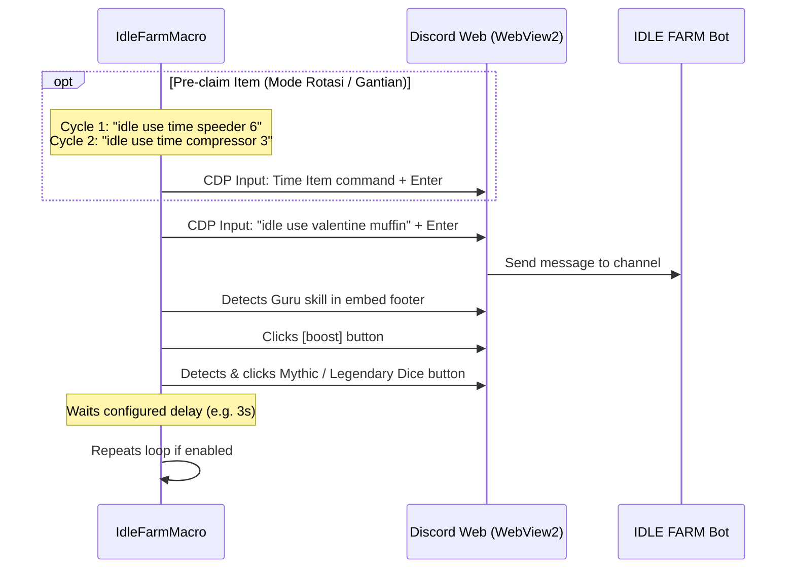

# Idle Farm Discord Macro

Lightweight, minimalist Windows desktop macro tool for automating claims in the Discord **IDLE FARM** bot (`1085406806492319784`). Built with .NET 8 and Microsoft WebView2 (Chromium).

---

## Features

- **Hardware-Level Input Automation:** Uses Chrome DevTools Protocol (CDP) to send keystrokes and text directly through Chromium with trusted events (`isTrusted: true`), bypassing Discord's synthetic event protections. No browser extensions (Tampermonkey) or token-based selfbots needed.
- **Customizable Pre-claim Commands (Speeder & Compressor):** Run custom time items before every Valentine Muffin claim.
  - **Mode Gantian / Rotasi (`🔄 Gantian`):** Alternates between time items on each cycle (e.g. Cycle 1: `idle use time speeder 6` ➔ Muffin; Cycle 2: `idle use time compressor 3` ➔ Muffin; Cycle 3: `idle use time speeder 6` ➔ Muffin; etc.).
  - **Mode Kirim Semua (`📑 Semua`):** Sends all configured commands sequentially in each cycle before claiming muffin.
  - **Direct Toolbar Toggle:** 1-click toggle directly on the top toolbar between `🔄 Gantian` and `📑 Semua`.
  - **Full Customization & Presets:** Add any custom text, reorder, delete, adjust delays (ms), or use 1-click presets for *Speeder 6*, *Compressor 3*, *Speeder 12*, *Compressor 6*, and *Duo (Speeder 6 & Compressor 3)*.
- **Smart Guru Detection:** Automatically reads bot response messages to check if the `your guru worker skill activated!` trigger is active.
- **Auto Dice Selection:** Clicks the boost button and automatically selects the desired dice based on emoji signatures (`alt: mythicdice` / `alt: legendarydice`).
  - Guru Active: Selects your configured dice (**Legendary** or **Mythic**).
  - Guru Inactive: Automatically falls back to **Mythic** dice.
- **Continuous Loop Mode:** Burns through your Valentine Muffins continuously with an adjustable cooldown delay (default 3 seconds). Automatically stops when items run out.
- **Settings Persistence:** Automatically saves your configurations (Guru dice, loop mode, delay, pre-claim command, rotation mode) to local config so they persist across sessions.
- **Resource & Memory Optimized:** Configured with Chromium renderer limits and background optimizations to keep CPU/GPU/RAM lightweight on gaming laptops.
- **Minimalist Dark UI:** Clean, distraction-free toolbar with native Windows 11 immersive dark mode titlebar.
- **Safe & Local:** Runs on your local Discord session. Never stores or logs Discord tokens or passwords.

---

## How It Works



---

## Prerequisites

- **Windows 10 / 11** (64-bit)
- **[.NET 8.0 Desktop Runtime](https://dotnet.microsoft.com/download/dotnet/8.0)** (Windows Desktop App runtime)
- **Microsoft Edge WebView2** (pre-installed on Windows 10 & 11)

---

## Installation & Usage

1. Download the latest release from the [Releases](https://github.com/Rahmat-Rifai/IdleFarmMacro/releases) page.
2. Extract the `.zip` archive to any folder.
3. Run `IdleFarmMacro.exe`.
4. Log in to your Discord account inside the application window.
5. Navigate to your server's bot channel where you run IDLE FARM commands.
6. Configure your options on the top bar:
   - **Guru dice:** Choose `Legendary` or `Mythic`.
   - **Loop terus:** Keep checked to continuously claim muffins.
   - **Jeda:** Cooldown delay between claims in seconds (default `3`s).
   - **Sebelum klaim:** Check to enable pre-claim command execution.
   - **Mode (`🔄 Gantian` / `📑 Semua`):** Click to toggle between alternating commands (1 item per cycle) or sending all items every cycle.
   - **Input teks:** Edit commands directly in the text box (separated by `;`).
   - **⚙️ Atur:** Open the full list manager to add custom commands, reorder items, adjust ms delay, or pick quick presets.
7. Click **Start**. The macro will execute the claim loop automatically. Click **Stop** at any time to pause.

---

## Building from Source

To compile the application yourself:

```bash
# Clone the repository
git clone https://github.com/Rahmat-Rifai/IdleFarmMacro.git
cd IdleFarmMacro

# Publish single-file release
dotnet publish -c Release -o ./publish -p:PublishSingleFile=true --self-contained false
```

The resulting executable will be located in the `./publish` directory.

---

## License

This project is licensed under the [MIT License](LICENSE).
